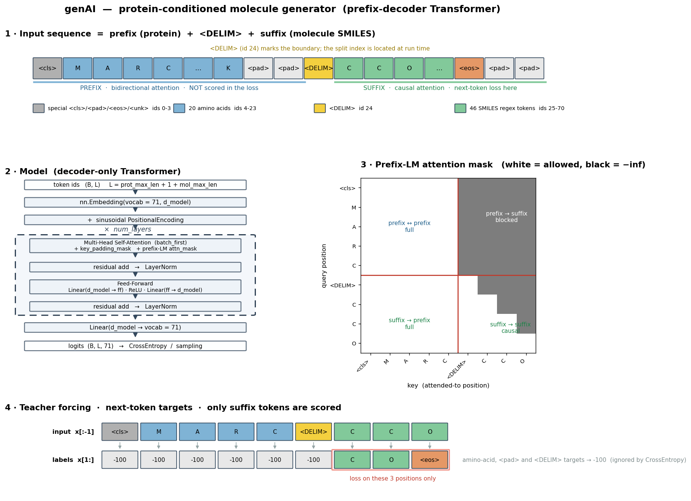

<a id="readme-top"></a>

# genAI💊

## Introduction
**genAI** is a generative model for early drug discovery: given a **protein target
sequence** it generates candidate **molecules (SMILES)** that are meant to bind
that target. It is trained on curated **protein–ligand pairs with confirmed
binding affinity**, so it learns, for a given protein, what its plausible binders
look like.

The model is a **prefix-decoder** (decoder-only Transformer): the protein sequence
is the *prefix* (read bidirectionally, like an encoder), and the molecule is the
*suffix*, generated left-to-right.

> **Project status.** Active development.

## Table of Contents
- [Introduction](#introduction) ✨
- [Model Architecture](#model-architecture) 🚀
- [Getting Started](#getting-started) 🛠️
- [Repository Structure](#repository-structure) 🔍
- [Usage](#usage) 📖
- [Configuration](#configuration) ⚙️
- [Data](#data) 🧬
- [Examples](#examples) 🧪
- [Contributing](#contributing) 🤝
- [License](#license) 📜
- [Contact](#contact) 📩
- [Acknowledgments](#acknowledgments) 👥

## Model Architecture




**Sequence.** One training example is a single token sequence

```
<cls> · protein residues · <pad>…  ‖  <DELIM>  ‖  molecule SMILES · <eos> · <pad>…
└──────────── prefix ────────────┘             └──────────── suffix ────────────┘
```

- **Tokenizer** (`utils/tokenizer.py`): one shared **71-token** vocabulary —
  4 special tokens (`<cls> <pad> <eos> <unk>`), the 20 amino acids, a `<DELIM>`
  boundary marker, and 46 regex-based SMILES tokens (atoms incl. aromatic
  `se`/`te`, bonds, ring digits, branches, charges). Protein padding uses
  `prot_max_length` (600), molecule padding `mol_max_length` (80).
- **Prefix-LM attention mask** (`create_prefix_decoder_mask`): prefix tokens
  attend to each other freely; suffix tokens use a causal mask and can read the
  whole prefix; prefix tokens cannot see the suffix. A boolean
  `key_padding_mask` removes `<pad>` positions.
- **Blocks**: token embedding → sinusoidal positional encoding → *N* ×
  `DecoderBlock` (`nn.MultiheadAttention` + FFN, post-norm residuals) →
  `Linear(d_model → vocab)`.
- **Loss**: cross-entropy on the **suffix only** — protein, `<pad>` and `<DELIM>`
  target positions are set to `-100` (ignored). The model gets no gradient for
  reproducing the protein.
- **Training modes** (`scheduled_sampling` in the config): teacher forcing,
  fully autoregressive, or scheduled sampling (linear / inverse-sigmoid /
  inverse-linear annealing of the teacher-forcing probability).
- **Generation** (`generate.py`): prompt with `<cls> + residues + <DELIM>`, then
  sample tokens autoregressively (temperature + multinomial) until `<eos>`.

Distributed training uses **Lightning Fabric** (DDP, `bf16-mixed`), with early
stopping, per-epoch or best-only checkpointing, resume-from-checkpoint and
optional **Weights & Biases** logging.

<p align="right">(<a href="#readme-top">back to top</a>)</p>

## Getting Started

```bash
git clone https://github.com/juliavilmor/genAI
cd genAI
```

The project runs in a conda environment named `genAI` (PyTorch 2.2 + CUDA,
`lightning`, `pandas`, `rdkit`, `wandb`, `torchinfo`, `scikit-learn`).

On the cluster:

```bash
module purge
ml bsc/1.0
source activate genAI
```

This is an ongoing project. I will provide further installation details once the project works...

<p align="right">(<a href="#readme-top">back to top</a>)</p>

## Repository Structure
```bash
genAI
├── models/
│   └── decoder_model.py     # the prefix-decoder model + attention masks
├── utils/                   # tokenizer, dataset/collate, early stopping, config, metrics
├── data/                    # datasets (git-ignored); data/splits/ holds the train/test splits
├── data_preparation/        # dataset curation / sequence-identity splitting scripts
├── configs/                 # training config YAMLs (params/, datasets/, model/, ...)
├── runs/                    # generated SLURM submission scripts (one per config)
├── scripts/                 # cluster helpers, param-count sweep, plotting
├── metrics/                 # per-epoch training metrics (CSV)
├── weights/                 # model checkpoints (git-ignored)
├── logs/                    # SLURM stdout/stderr (git-ignored)
├── tests/                   # evaluation harness + generated-molecule results
├── examples/                # example config
├── wandb/                   # W&B run files (git-ignored)
├── train.py                # training entry point
└── generate.py             # molecule generation
```

<p align="right">(<a href="#readme-top">back to top</a>)</p>

## Usage

**1. Train** (multi-GPU via SLURM):

```bash
python train.py --config configs/params/config_params_30M.yaml
# on the cluster: sbatch runs/params/run_params_30M.sh
```

**2. Evaluate** a checkpoint: generates molecules for the four
sequence-identity test buckets and reports validity / uniqueness / novelty:

```bash
python tests/test.py \
  --weights_file weights/<checkpoint>.pth \
  --outdir tests/<run_name> \
  --outname results
```

**3. Generate** molecules for a specific target: edit the sequence and
`weights_path` in the `__main__` block of `generate.py`, then:

```bash
python generate.py
```

**Utilities**

```bash
python scripts/calculate_parameters.py       # enumerate (d_model, heads, ff, layers) by param count
```

<p align="right">(<a href="#readme-top">back to top</a>)</p>

## Configuration

Training is driven entirely by a YAML config (see [`examples/config.yaml`](examples/config.yaml)):

```yaml
data_path: 'data/splits/training_split.csv'  # training data (CSV)
col_prots: 'Sequence'                        # protein-sequence column
col_mols: 'SMILES'                           # SMILES column

# model
d_model: 256                                 # embedding / hidden dimension
num_heads: 4                                 # attention heads
ff_hidden_layer: 2560                        # feed-forward hidden dimension
num_layers: 19                               # number of decoder blocks
dropout: 0.1
prot_max_length: 600                         # max protein length (padded)
mol_max_length: 80                           # max SMILES length (padded)

# optimisation
batch_size: 64
num_epochs: 50
learning_rate: 0.0001
loss_function: 'crossentropy'
label_smoothing: False                       # or a float, e.g. 0.1
optimizer: 'AdamW'                            # 'Adam' | 'AdamW'
weight_decay: 0.001
betas: [0.9, 0.99]
scheduled_sampling: 0                         # 0 = teacher forcing, 1 = autoregressive,
                                             # 'prob_lin' | 'prob_invsig' | 'inv_prob_lin'
es_patience: 6                               # early-stopping patience
es_delta: 0.0001                             # early-stopping min. improvement
seed: 1234

# run
num_gpus: 4
validation_split: 0                          # fraction held out for validation (0 = none)
weights_path: 'weights/partB/weights_dm256_nh4_ff2560_nl19_params_30M.pth'
checkpoint_epoch: False                      # True = save every epoch, False = keep last
resume_training: False                       # or a wandb run name to resume from
get_wandb: False                             # log to Weights & Biases
wandb_project: 'train_decoder_partB'
wandb_name: 'partB_params_30M'
verbose: 1                                   # 0, 1, or 2
```

<p align="right">(<a href="#readme-top">back to top</a>)</p>

## Data

Training data is a CSV of `Uniprot, Compound_ID, SMILES, Sequence` rows (one
protein–ligand pair per row), curated from **ChEMBL + BindingDB** and, more
recently, **SMPBind** (`data_preparation/`).

The held-out test sets in `data/splits/` are split by **sequence identity to the
training set** so generalisation can be measured at different distances:

| file | identity to training |
|---|---|
| `test_90.csv`    | > 90 %  (near-memorisation) |
| `test_60_90.csv` | 60–90 % |
| `test_40_60.csv` | 40–60 % |
| `test_0_40.csv`  | < 40 %  (true generalisation) |

Large CSVs and checkpoints are **git-ignored**.

<p align="right">(<a href="#readme-top">back to top</a>)</p>

## Examples
See [`examples/config.yaml`](examples/config.yaml) for a small runnable config.
More worked examples to follow.

<p align="right">(<a href="#readme-top">back to top</a>)</p>

## Contributing
Contributions are welcome. Please open an issue or pull request.

**Top contributors:**

<a href="https://github.com/juliavilmor/genAI/graphs/contributors">
  
</a>

<p align="right">(<a href="#readme-top">back to top</a>)</p>

## License
This project is licensed under the x License. See LICENSE for more details.

<p align="right">(<a href="#readme-top">back to top</a>)</p>

## Contact
Júlia Vilalta-Mor - julia.vilalta@bsc.es  

Supervisors: Isaac Filella-Mercè - isaac.filella1@bsc.es   |   Víctor Guallar - victor.guallar@bsc.es

<p align="right">(<a href="#readme-top">back to top</a>)</p>

## Acknowledgments

This work has been supported by the project ARTIBAND, CPP2022-009737, financed by MICIU/AEI/10.13039/501100011033 and by the European Union NextGenerationEU/PRTR.

<p align="right">(<a href="#readme-top">back to top</a>)</p>
